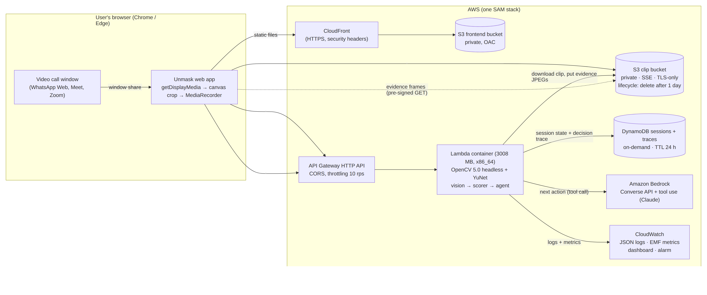
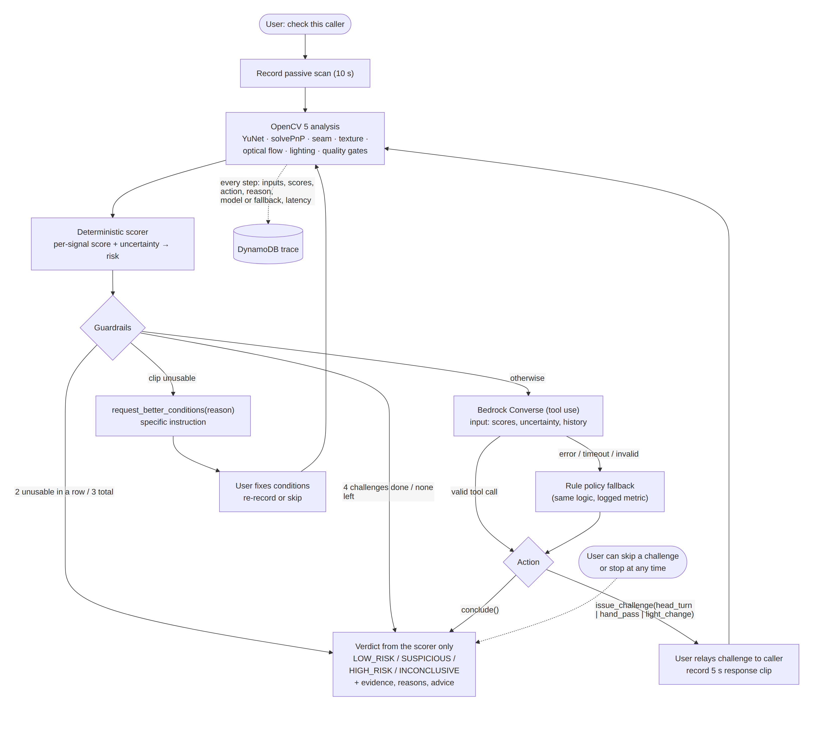
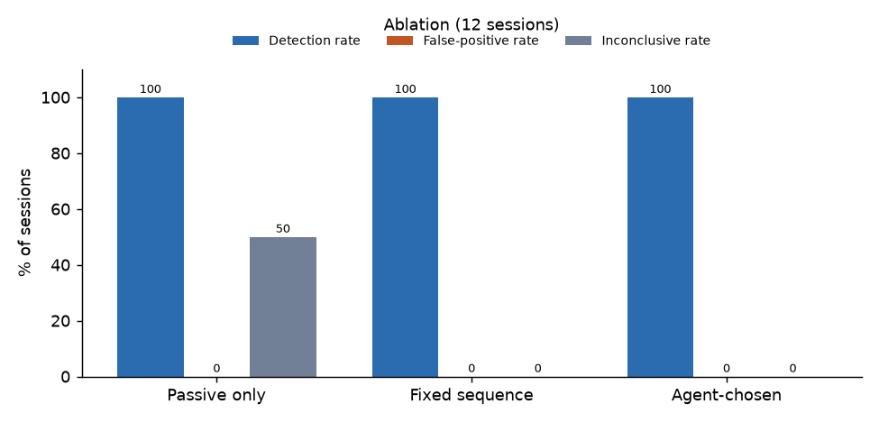

# Unmask: technical report

**OpenCV AI Competition 2026 (powered by AWS) · Agentic Vision track**

> **Status of the numbers in this report.** Every number below was produced by the code in this
> repository. Results on **real recorded footage are not available yet**: those cells are marked
> **⏳ PENDING (real data)** and will be filled by `make eval` once the recordings described in
> [DATA_COLLECTION.md](DATA_COLLECTION.md) exist. The only detection numbers currently available come
> from **synthetic cartoon fixtures** (§6.2). They prove the pipeline runs end to end and **say
> nothing about real-world detection performance**. AWS figures (§6.3, §7) were measured on the live
> deployment in eu-north-1 with `make smoke` on 2026-10-25, using the synthetic sample clips.

## 1. Problem

Real-time face-swap software now runs on consumer GPUs and plugs into WhatsApp, Google Meet or Zoom
as a virtual camera. Fraudsters use it to pose as relatives in an emergency, romantic partners,
executives or recruiters, and then ask for money, codes or personal data. A single video frame of
a good swap is hard to tell apart from a real face, and the people targeted are often not experts.

A live swap does have a weakness: it is rendered frame by frame from a model trained mostly on
frontal, unoccluded, evenly lit faces. When the real person behind it **turns to profile, passes a
hand in front of the face, or changes the lighting**, the illusion tends to break: the blend seam
flickers, landmarks jump, the face is painted *over* the hand, and the face's brightness stops
following the scene. Unmask turns that observation into a guided, explainable check that anyone can
run during a call.

## 2. Users and use

The primary user is a person on a suspicious video call: a parent who gets a call from a "child"
asking for money, an employee called by the "CEO", someone in an online relationship. They open
Unmask in a browser tab beside the call, share the call window, read out the challenges Unmask
suggests, and get a cautious verdict with plain advice. Secondary users are fraud-prevention and
helpdesk staff, who can use upload mode on a recorded call.

Design constraints that follow from this:

- **No setup, no install:** a web page; window sharing via `getDisplayMedia` (desktop Chrome / Edge).
- **The human stays in control:** Unmask advises only. It never ends calls, contacts anyone, or
  identifies the caller. Every challenge can be skipped, and the check can be stopped at any time.
- **Honest uncertainty:** four outcomes (LOW_RISK / SUSPICIOUS / HIGH_RISK / **INCONCLUSIVE**), with
  advice that is safe whatever the verdict: verify through a channel you already trust.

## 3. Architecture



Details: [architecture.md](architecture.md). In short:

| Layer | AWS service | Notes |
|---|---|---|
| Frontend | S3 (private) + CloudFront (OAC, HTTPS, security headers) | Vanilla JS, no build step |
| API | API Gateway HTTP API | CORS locked to the CloudFront origin; throttled to 10 req/s (burst 20) |
| Analysis + agent | Lambda **container image** (3008 MB, 60 s) | OpenCV 5.0 headless + YuNet baked in; the Docker build fails if `cv2.__version__` isn't 5.x or the model checksum differs |
| Clips + evidence | S3 (private, SSE, TLS-only, Block Public Access) | Pre-signed POST (10 min, ≤ 60 MB, content type locked); **lifecycle rule deletes everything after 1 day** |
| Sessions + traces | DynamoDB on-demand | Optimistic locking; **TTL 24 h** |
| Agent model | Amazon Bedrock, Converse API with tool use | Default Amazon Nova Lite (`eu.amazon.nova-lite-v1:0`), configurable |
| Observability | CloudWatch Logs (JSON) + EMF custom metrics + dashboard + alarm | Clip latency, verdicts, inconclusive rate, errors, Bedrock fallbacks |
| IaC | AWS SAM (`template.yaml`) | Least-privilege role, no secrets in code |

Video never passes through API Gateway: the browser uploads straight to S3, then calls
`POST /sessions/{id}/clips`, which runs the vision pipeline, scorer and agent in a single Lambda
invocation and returns the next action.

## 4. OpenCV 5 implementation

Verified version: **`opencv-python-headless==5.0.0.93`, `cv2.__version__ == "5.0.0"`** (checked by
`make setup`, the unit tests, the Docker build and the `/health` endpoint). Face detector: **YuNet**
`face_detection_yunet_2023mar.onnx`, SHA-256 `8f2383e4…52fa4`. All vision code is in
`unmask/vision/` (pure Python + OpenCV + NumPy, no AWS imports), so the same code runs locally,
in the eval harness and in Lambda.

**Pre-processing.** `cv2.VideoCapture` decodes the clip. Browser MediaRecorder WebM often has no
duration and a bogus FPS, so frames are timed with `CAP_PROP_POS_MSEC` when it advances (else by
FPS), resampled onto a 10 fps grid, and downscaled to ≤ 640 px wide with `INTER_AREA`.

| # | Signal | OpenCV 5 functions | What it measures |
|---|---|---|---|
| 1 | Face + landmarks | `cv2.FaceDetectorYN` | Per-frame box, 5 landmarks, confidence; single-face tracking; detection flicker per second; confidence spread |
| 2 | Head pose | `cv2.solvePnP` (EPnP → iterative), `cv2.Rodrigues`, `cv2.projectPoints` | Yaw trajectory from a generic 3D 5-point face model (blended with a geometric nose-offset proxy for robustness near profile); PnP reprojection error as a geometric-consistency check; behaviour at high yaw (confidence jerk, landmark jumps, seam gain) |
| 3 | Face-boundary seam | `cv2.warpAffine` (face-aligned crop), `cv2.Sobel`, `cv2.magnitude`, `cv2.cvtColor` (Lab) | Edge energy in an elliptical band at the face boundary vs. just inside and outside; Lab colour step across the band in 8 jaw/cheek sectors (median, robust to hair); frame-to-frame flicker in the band vs. the face interior |
| 4 | Occlusion (hand pass) | `cv2.calcOpticalFlowFarneback`, `cv2.createBackgroundSubtractorMOG2`, `cv2.morphologyEx` | Moving-pixel mask over the face; whether the face is still detected with high confidence while ≥ 20 % of it is covered; confidence drop; **texture leak** = correlation between the moving region and the pre-occlusion face (a swap paints the face over the hand); landmark jumps during occlusion |
| 5 | Lighting | `cv2.cvtColor` (Lab L), masks drawn with `cv2.ellipse` | Correlation of the face's luminance changes with the neck and the background; gain deviation; left/right asymmetry tracking (side light) |
| 6 | Texture / sharpness | `cv2.Laplacian`, NumPy FFT | Laplacian variance of the face vs. the background (log ratio); high-frequency spectral energy of the face vs. a same-scale scene patch |
| 7 | Response latency | (from 2, 4, 5) | Time from clip start (challenge issued) to the onset of the requested motion |
| 8 | Quality gates | `cv2.Laplacian`, Lab L | Too few frames, low FPS, no face, face too small (< 60 px), too dark, too blurry, **challenge not performed** (yaw range < 25°, occlusion < 25 %, light change < 6 L units) → unusable, with a specific instruction |

**Evidence frames.** Up to three annotated JPEGs per clip (`cv2.rectangle`, `cv2.ellipse2Poly` for
the seam band, `cv2.circle` for landmarks, red motion overlay, `cv2.imencode`): the strongest seam
frame, the maximum head turn, the hand-over-face moment, or the after-light frame.

**OpenCV 5 note (measured).** YuNet under OpenCV 5's new DNN graph engine took **63 ms/frame at
640×480 but 17 ms/frame at 320×240** on our laptop CPU (the engine logs that targets are not yet
supported by the new graph engine). `FaceDetectorYN` exposes no engine switch, so detection runs on
a 320 px copy and boxes and landmarks are scaled back. Farneback flow runs at 192 px. Together these
brought a 5 s clip from ~8 s to ~2–4 s locally (§6.3).

## 5. Agent design (Agentic Vision)



Details: [agent-workflow.md](agent-workflow.md).

**State the agent sees.** After each clip the deterministic scorer turns features into seven signal
scores (seam, texture, temporal, pose, occlusion, lighting, latency), each with an uncertainty
(`1 − |2s − 1|` scaled by feature coverage; unmeasured = 1), plus the session risk, the challenges
done, the last clip's usability and reason, and which signals each challenge resolves.

**Actions (tool use).** `issue_challenge(head_turn | hand_pass | light_change, reason)`,
`request_better_conditions(instruction, reason)`, `conclude(reason)`. The model must give a
one-sentence reason citing the signal values, which is stored in the trace and shown to the user.

**Policy.** The rule policy picks the untried challenge that maximises
`Σ signal_weight × uncertainty` over the signals it resolves (borderline seam/pose → head turn;
untested or odd lighting → light change; borderline texture/occlusion → hand pass). The Bedrock
agent receives the same state and principle. **Guardrails run first and can't be overridden:** an
unusable clip forces `request_better_conditions`; 2 unusable clips in a row or 3 in total, 4
challenges, or no challenges left force `conclude`. Every model tool call is validated (available?
not already done? within budget? has a reason?). Errors, timeouts or invalid calls fall back to the
rule policy, which is logged with the reason and counted in the `BedrockFallbacks` metric.

**The verdict never comes from the LLM.** `conclude` only stops the loop. The verdict, risk, top
reasons and advice are computed by `unmask/scoring` from a versioned JSON config.

**Model choice.** The decision is a single small tool call per step, so the default is the fast,
cheap **Amazon Nova Lite** via the EU cross-region inference profile (`eu.amazon.nova-lite-v1:0`,
used exactly as given; the stack runs in eu-north-1). It's switchable with one stack parameter. Requests
are shaped per model family: for Nova, greedy decoding (temperature 0, top-k 1) and tool schemas
without `additionalProperties`; Claude IDs still work. Tool calls are normalised (JSON-string input,
enum case) before validation, so a malformed answer becomes a logged fallback, not an error.
`toolChoice` is `auto`; the prompt asks for exactly one call and the validator enforces it.

**Proof that vision output changes decisions.** [AGENT_TRACE_EXAMPLE.json](AGENT_TRACE_EXAMPLE.json)
is an exported trace (currently from a **synthetic** session, provenance recorded in the file):

| Step | What OpenCV reported | Agent decision | Why (from the trace) |
|---|---|---|---|
| 1 | Passive clip usable, risk 0.139; seam (0.11) and temporal (0.08) already clear, uncertainty 0.25 / 0.17; texture less so (0.22, uncertainty 0.45) | `issue_challenge(hand_pass)` | expected uncertainty resolved: hand pass 1.66 > head turn 1.57 > light change 1.46. The head turn's seam/temporal targets were already settled, so the default first challenge was skipped |
| 2 | Hand-pass clip usable, risk 0.141 | `issue_challenge(head_turn)` | pose unmeasured (1.50) |
| 3 | Head-turn clip **unusable: no_face** | `request_better_conditions` (guardrail) | the last clip was unusable |
| 4 | User skipped the head turn | `issue_challenge(light_change)` | lighting unmeasured (1.47) |
| 5 | Light-change clip usable, risk 0.143 | `conclude` | no challenges left → LOW_RISK |

In the synthetic evaluation the agent's first challenge was not always the default: 1 of 12
sessions started with `hand_pass`, and 3 sessions concluded after one or two challenges because the
early-stop rule was already satisfied (§6.2). ⏳ PENDING (real data): the same analysis on real recordings.

## 6. Evaluation

Harness: `eval/run_eval.py`. Each clip is analysed once and cached. Thresholds are fitted
**leave-one-participant-out** (LOPO) with `unmask/scoring/tune.py` (feature centre = midpoint of the
class medians, scale from the robust spread, weight = clipped d′), so every participant is scored
with a config that never saw their clips. **With a single participant that is impossible, so the harness
falls back to leave-one-session-out** (each recording session is scored with thresholds fitted on the
other sessions); the results file states which scheme was used. Three strategies are replayed offline on the same clips:
(a) passive only, (b) fixed sequence head turn → hand pass → light change, (c) agent-chosen.

### 6.1 Real recordings: ⏳ PENDING (real data)

| Metric | Passive only | Fixed sequence | Agent-chosen |
|---|---|---|---|
| Detection rate (swapped flagged SUSPICIOUS/HIGH_RISK) | ⏳ | ⏳ | ⏳ |
| False-positive rate (real flagged) | ⏳ | ⏳ | ⏳ |
| Inconclusive rate | ⏳ | ⏳ | ⏳ |
| Average challenges to verdict | ⏳ | ⏳ | ⏳ |

| Per-challenge (passive + that challenge) | Detection | False positives |
|---|---|---|
| head_turn | ⏳ | ⏳ |
| hand_pass | ⏳ | ⏳ |
| light_change | ⏳ | ⏳ |

Participants: ⏳ (target ≥ 6, see DATA_COLLECTION.md) · skin-tone and lighting coverage: ⏳ ·
through-a-real-call variants: ⏳ · failure cases with frames: ⏳ (will be in `docs/results/results.md`).

### 6.2 Synthetic pipeline check (not evidence of real-world performance)

48 clips, 6 procedurally drawn cartoon "participants" (no real people), each with a "real" and a
"swap-like" set of four clips. The swap-like variants were **designed** to contain the artefacts
the signals look for, so near-perfect separation is expected and meaningless as a detection claim.
They show the full loop (decode → YuNet → signals → LOPO thresholds → agent → verdict) runs on
real video files. Source: [results/synthetic/results.md](results/synthetic/results.md).

| Strategy | Detection | High-risk on swaps | False positives | Inconclusive | Avg challenges |
|---|---|---|---|---|---|
| (a) Passive only | 100 % | 33.3 % | 0 % | 50 % | 0 |
| (b) Fixed sequence | 100 % | 83.3 % | 0 % | 0 % | 2.92 |
| (c) Agent-chosen | 100 % | 83.3 % | 0 % | 0 % | **2.50** |

What this does show: passive analysis alone left half the sessions INCONCLUSIVE (by design, LOW_RISK
needs at least one challenge), challenges raised the share of swaps rated HIGH_RISK from 33 % to 83 %,
and the agent reached the same verdicts with fewer challenges than the fixed sequence (2.50 vs 2.92)
by stopping as soon as the early-stop rule was met. One clip was rejected by the quality gate (`no_face`) and the
agent recovered by asking for better conditions and moving on.



### 6.3 Latency

| Clip (frames after 10 fps resampling) | Local p50 | Local p95 | Lambda OpenCV analysis (3 smoke sessions) |
|---|---|---|---|
| passive (8 s, 80 frames) | 3.57 s | 4.46 s | 0.88 s warm; 8.4–8.5 s on the first clip after a cold start |
| head_turn (5 s) | 1.93 s | 2.09 s | 0.50–0.60 s |
| hand_pass (5 s) | 3.83 s | 4.21 s | 1.93–2.09 s |
| light_change (5 s) | 3.02 s | 3.25 s | 0.77–1.42 s |

Local = Ubuntu laptop CPU (8 threads), measured by the eval harness on the synthetic clips, while
another process was also using the CPU. All are well inside API Gateway's 30 s integration limit.
A MediaRecorder WebM recorded in the browser (5.2 s, 15 fps) decoded and analysed correctly through
the local API.

**Lambda (eu-north-1, 3008 MB, x86_64).** Warm OpenCV analysis is faster than on the laptop. The
first clip after a cold start pays ~8.4 s while the container image's OpenCV layers load lazily. The
very first invocation of a freshly deployed image exceeded Lambda's 10 s init limit and the request
timed out at API Gateway's 30 s; an EventBridge keep-warm ping every 5 minutes and a one-time client
retry for safe calls now cover this. Client round trips from Lagos (upload excluded, analysis + Nova
decision + DynamoDB + network) were 6.2–13.1 s, median 10.8 s in the last smoke run
([lambda_latency.json](results/lambda_latency.json)).

**Agent on Bedrock (live).** Across the smoke sessions Amazon Nova Lite (`eu.amazon.nova-lite-v1:0`)
made **8 decisions with 0 fallbacks**, median **1.01 s** per decision (max 1.19 s); the remaining
steps were guardrail `conclude`s when no challenge was left. Nova consistently opened with
`light_change` on these clips where the rule policy usually picks `head_turn`. Both are valid under
the guardrails; whether that order helps on real swaps is ⏳ PENDING (real data, `--bedrock` replay).

### 6.4 Failure handling, observability and human control

| Aspect | How it is evaluated |
|---|---|
| Task success | Ablation detection / FPR / inconclusive / challenges-to-verdict (§6.1–6.2) |
| Failure handling | Unit tests: unusable clip → `request_better_conditions` with the gate's reason; 2 unusable in a row → INCONCLUSIVE; ≤ 4 challenges; Bedrock timeout / invalid tool / unavailable challenge → rule fallback; guardrail overrides the model on unusable clips; bare model ID rejected → regional inference profile retried and cached (49 tests in `tests/`, incl. mocked Nova responses) |
| Observability | Each step's inputs, scores, action, reason, policy (bedrock / rule_fallback / guardrail / human), model ID and latency are stored in DynamoDB and downloadable as JSON. CloudWatch EMF metrics: `ClipLatencyMs`, `AnalysisLatencyMs`, `AgentLatencyMs`, `Verdicts`, `InconclusiveRate`, `BedrockFallbacks`, `Errors`, `ClipsAnalysed`; dashboard and error alarm defined in `template.yaml` |
| Human control | Skip any challenge (`/skip`), stop any time (`/finish`), delete everything now (`DELETE /sessions/{id}`); the agent cannot end calls or contact anyone |

## 7. AWS deployment and reproducibility

```bash
make setup && make test                     # pinned deps, YuNet checksum, 49 tests
make check-bedrock REGION=eu-north-1         # which Bedrock models/profiles the account can call
sam build && sam deploy --guided             # whole stack
make deploy-frontend && make smoke           # upload site, end-to-end test, record Lambda latency
```

No local Docker? `make remote-deploy` builds the image in CodeBuild (from the pushed GitHub commit)
and deploys it; that is how the live stack was deployed over a slow connection.

Live endpoint: **https://d2xv52l4vknsio.cloudfront.net** (API `https://flqstgd5x1.execute-api.eu-north-1.amazonaws.com`, stack
`unmask` in eu-north-1). Verified live: S3 lifecycle rule `delete-everything-after-1-day` enabled,
Block Public Access on, DynamoDB TTL on `expires_at` enabled, CloudWatch dashboard `unmask-unmask`
receiving the custom metrics. `make serve` runs the exact Lambda handler locally against
file storage, so the app can be reviewed without an AWS account.

## 8. Limitations

- **No real-data results yet** (§6.1). The v0 thresholds are hand-set priors; they must be refitted
  with `eval/run_eval.py --write-config` before the verdicts mean anything on real calls.
- **Small participant pool** (planned ≥ 6): results will not transfer perfectly to other people,
  cameras or call apps.
- **Single participant, leave-one-session-out (current real data).** The recordings so far are of one person
  in three lighting sessions, and every swap uses the same synthetic source face and swap model. Thresholds are
  therefore cross-validated leave-one-*session*-out, not leave-one-*participant*-out. That is a weaker check:
  the sessions share the same face, camera and swap source, so it overstates how well the thresholds will
  generalise to new people, other cameras or other swap tools. It says nothing about skin-tone coverage.
- **Compression:** call apps re-encode video heavily, which can hide seam and texture artefacts or
  create false ones. The through-a-real-call recordings are meant to measure this.
- **Adversaries adapt:** better swap models, refusing challenges, or occluding deliberately can
  defeat individual signals. Unmask raises the cost of a fake; it doesn't make one impossible.
- **Detector bias:** face detection and texture measures vary with skin tone, exposure and camera
  quality; quality gates push poor conditions towards INCONCLUSIVE, but coverage is limited.
- **Browser support:** window sharing works in desktop Chrome/Edge (and recent Firefox), not on
  mobile; upload mode covers those cases.
- **OpenCV 5 DNN speed:** YuNet runs at reduced resolution for CPU latency, which halves landmark
  precision on small faces.

## 9. Responsible use

See [RESPONSIBLE_USE.md](RESPONSIBLE_USE.md): 24 h deletion (S3 lifecycle + DynamoDB TTL + delete
button), no face database, no recognition or identification, consent-only test data with
pseudonyms, AI-generated swap faces of no real person (never a celebrity), no face-swap tooling in
the repository, an explicit INCONCLUSIVE outcome, and advice that holds whatever the verdict.
