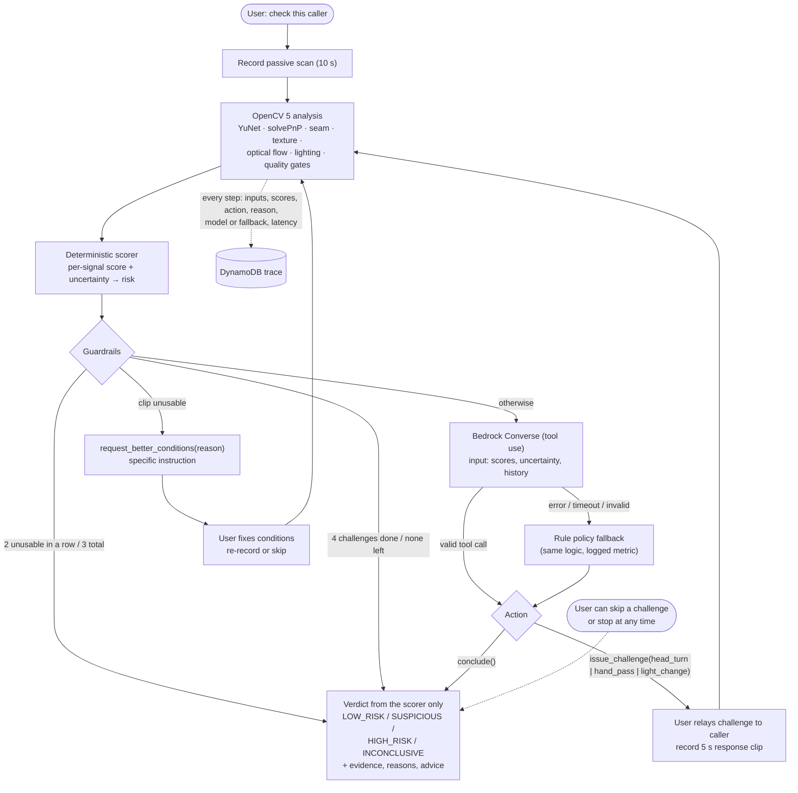

# Agent workflow

## How vision output drives the next decision

After every clip the scorer turns OpenCV measurements into seven signal scores with an
uncertainty each (`1 − |2s − 1|`, scaled by coverage; unmeasured = 1). Each challenge "resolves" a
set of signals:

| Challenge | Signals it measures | Chosen when … |
|---|---|---|
| `head_turn` | seam, pose, temporal | the face-edge seam or landmark stability is borderline |
| `hand_pass` | occlusion, texture | texture mismatch is borderline, or occlusion is untested |
| `light_change` | lighting, texture | lighting is untested / odd |

The rule policy picks the untried challenge with the largest
`Σ signal_weight × uncertainty` over the signals it resolves. The Bedrock agent receives the same
state and the same `resolves` table and is instructed to follow that principle, explaining its
choice in one sentence; its tool call is validated (available? not yet done? within budget?) and
replaced by the rule policy if invalid. So when, for example, a head-turn clip makes the seam and
pose signals decisive, their uncertainty collapses and the next choice moves to `hand_pass`; if the
user cannot do a hand pass, it moves to `light_change`. The exported trace
(`docs/AGENT_TRACE_EXAMPLE.json`) shows the before/after scores next to each decision.

## Stopping rules

- **Confident early stop:** risk ≥ 0.78 after ≥ 1 challenge, or risk ≤ 0.28 after ≥ 2 challenges
  with no signal uncertainty above 0.6 (`stop` in the scoring config). The rule policy concludes;
  the Bedrock agent is told `confident=true` and normally concludes.
- **Budget:** at most 4 challenge attempts per session.
- **Failure handling:** an unusable clip always triggers `request_better_conditions` with a specific
  instruction (too dark, face too small, …); 2 unusable clips in a row or 3 in total end the session
  as INCONCLUSIVE.
- **Human control:** skip any challenge (`/skip`), stop at any time (`/finish`), delete everything
  (`DELETE /sessions/{id}`).
