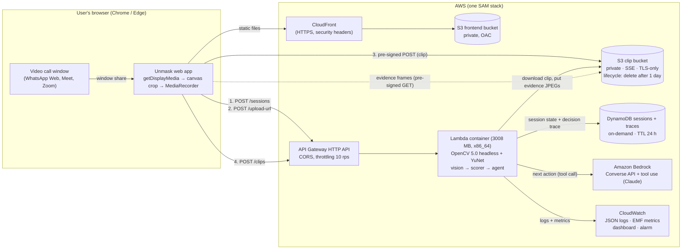

# Architecture

## Request flow for one clip

1. The browser asks for a pre-signed POST (`/sessions/{id}/upload-url`, 10 min, ≤ 60 MB, content
   type locked) and uploads the 5–10 s WebM straight to S3. Video never passes through API Gateway.
2. `POST /sessions/{id}/clips` invokes the Lambda, which:
   - decodes the clip with OpenCV, downsamples to ≤ 640 px wide and ~10 fps;
   - runs YuNet face detection + landmarks, solvePnP head pose, seam / texture / optical-flow
     occlusion / lighting / latency signals, and the quality gates (`unmask/vision`);
   - writes 1–3 annotated evidence frames to S3;
   - updates the deterministic scores (`unmask/scoring`) and asks the agent for the next action
     (`unmask/agent`: guardrails → Bedrock Converse tool call → rule-based fallback);
   - appends a trace step and saves the session to DynamoDB (optimistic locking);
   - emits structured logs and EMF metrics.
3. The response carries the clip's measurements, the next action (challenge prompt to read out,
   a request for better conditions, or the final verdict), and pre-signed evidence URLs.

A 5 s clip analyses in well under API Gateway's 30 s integration limit (see
`docs/results/results.md` for measured latencies).

## Components

| Component | Code | Notes |
|---|---|---|
| Vision signals | `unmask/vision/` | Pure Python + OpenCV + NumPy; no AWS imports. Same code locally and in Lambda. |
| Scorer | `unmask/scoring/` | Versioned JSON configs (`config/scoring_v*.json`); verdicts are computed only here. |
| Agent | `unmask/agent/` | `policy.py` (rules + guardrails), `bedrock.py` (Converse tool use), `session.py` (state machine + trace). |
| API | `backend/app.py` | One Lambda handler for all routes; storage pluggable (`backend/storage.py`). |
| Local mode | `backend/local_server.py` | Same handler + local file storage, for development and judges without AWS. |
| IaC | `template.yaml`, `Dockerfile` | `sam build && sam deploy --guided`. |
| Frontend | `frontend/` | Vanilla JS, no build step. |

## IAM (least privilege)

The Lambda role can only: `s3:GetObject/PutObject/DeleteObject` on `clips/*` and `evidence/*` of
the clip bucket, `s3:ListBucket` on those prefixes (for user-initiated delete), `dynamodb:GetItem/
PutItem/DeleteItem` on the session table, and `bedrock:InvokeModel` on Anthropic foundation models
and this account's inference profiles. No secrets exist in code or configuration: AWS access is via
the execution role.
