# Evaluation results

> **Data:** recorded clips in data  
> 24 clips · 1 participants · 6 sessions · generated 2026-10-26 13:49 · thresholds fitted leave-one-session-out (3 folds)

> ⚠️ **Limitation: single participant.** Leave-one-participant-out is impossible with one person, so thresholds were fitted **leave-one-session-out**. The sessions share the same face, camera and swap source, so this check is weaker and overstates how well the thresholds will generalise to new people. More participants are needed for a real generalisation estimate.

## Ablation: does choosing challenges adaptively help?

| Strategy | Detection rate (swapped flagged) | High-risk on swapped | False-positive rate (real flagged) | Inconclusive | Swaps missed as LOW_RISK | Avg challenges |
|---|---|---|---|---|---|---|
| (a) Passive only | 66.7% | 33.3% | 66.7% | 33.3% | 0.0% | 0 |
| (b) Fixed sequence | 66.7% | 0.0% | 66.7% | 0.0% | 33.3% | 3 |
| (c) Agent-chosen | 66.7% | 0.0% | 66.7% | 0.0% | 33.3% | 2.67 |

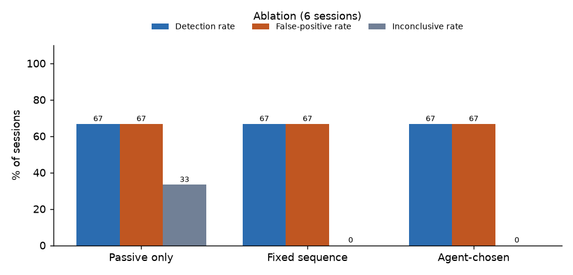

## Per-challenge detection (passive + that one challenge)

| Challenge | Detection rate | False-positive rate | n real | n swapped |
|---|---|---|---|---|
| head_turn | 100.0% | 100.0% | 3 | 3 |
| hand_pass | 33.3% | 66.7% | 3 | 3 |
| light_change | 66.7% | 33.3% | 3 | 3 |

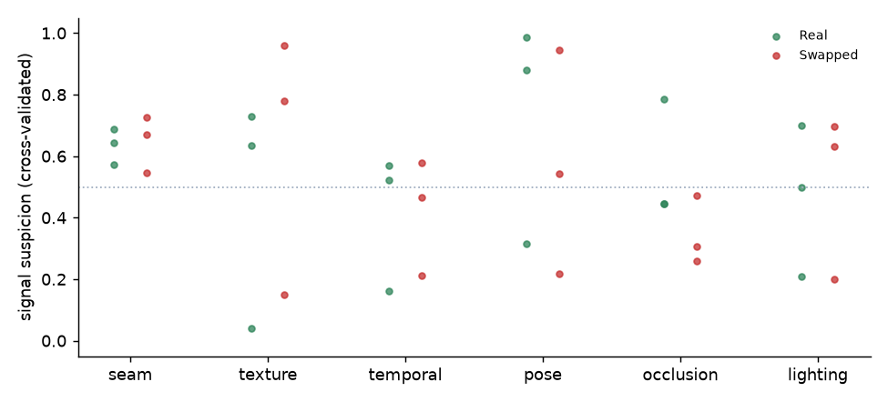

## Latency per clip

| Clip | Local p50 (ms) | Local p95 (ms) | Local max (ms) | n |
|---|---|---|---|---|
| passive | 4774.5 | 5308.1 | 5459.4 | 6 |
| head_turn | 2526.8 | 2556.4 | 2792.5 | 6 |
| hand_pass | 5004.5 | 5518.1 | 5908.1 | 6 |
| light_change | 3978.9 | 4242.3 | 4326.7 | 6 |

Lambda (from `make smoke`):

```json
{
  "api": "flqstgd5x1.execute-api",
  "measured_at": "2026-10-26 14:09",
  "clips": [
    {
      "challenge": "passive",
      "roundtrip_ms": 23527.0,
      "analysis_ms": 8527.0,
      "frames": 100,
      "usable": true,
      "sample": "real-daylight"
    },
    {
      "challenge": "light_change",
      "roundtrip_ms": 8336.0,
      "analysis_ms": 1729.6,
      "frames": 60,
      "usable": true,
      "sample": "real-daylight"
    },
    {
      "challenge": "hand_pass",
      "roundtrip_ms": 11209.1,
      "analysis_ms": 2348.0,
      "frames": 60,
      "usable": true,
      "sample": "real-daylight"
    },
    {
      "challenge": "head_turn",
      "roundtrip_ms": 3919.2,
      "analysis_ms": 792.9,
      "frames": 60,
      "usable": true,
      "sample": "real-daylight"
    },
    {
      "challenge": "passive",
      "roundtrip_ms": 3911.8,
      "analysis_ms": 1373.8,
      "frames": 100,
      "usable": true,
      "sample": "swap-daylight"
    },
    {
      "challenge": "light_change",
      "roundtrip_ms": 5592.7,
      "analysis_ms": 1097.2,
      "frames": 60,
      "usable": true,
      "sample": "swap-daylight"
    },
    {
      "challenge": "hand_pass",
      "roundtrip_ms": 4503.0,
      "analysis_ms": 1391.2,
      "frames": 60,
      "usable": true,
      "sample": "swap-daylight"
    },
    {
      "challenge": "head_turn",
      "roundtrip_ms": 3483.2,
      "analysis_ms": 797.6,
      "frames": 60,
      "usable": true,
      "sample": "swap-daylight"
    }
  ],
  "roundtrip_ms_median": 5047.9,
  "analysis_ms_median": 1382.5,
  "note": "roundtrip = client->API Gateway->Lambda (analysis + agent + DynamoDB) -> client; includes cold start on first clip"
}
```

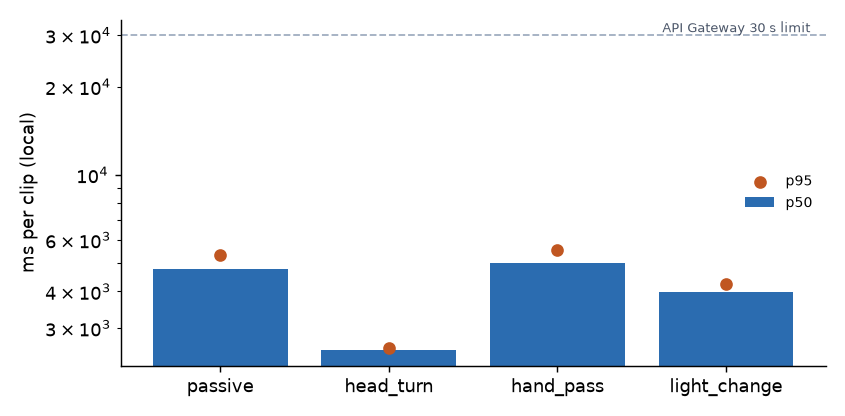

## Agent behaviour

Challenge orders the agent chose:

- `head_turn > hand_pass > light_change`: 4 sessions
- `hand_pass > head_turn`: 2 sessions

Decision sources: rule: 18, guardrail: 4

## Unusable clips

- none

## Failure cases (3)

### p01 · swapped · daylight → LOW_RISK (risk 0.435)
- The face is noticeably smoother or blurrier than the rest of the picture.
- The face stayed consistent through a full head turn.
- The face's lighting changed together with the rest of the scene.
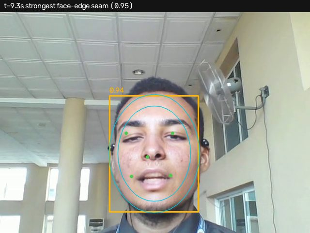
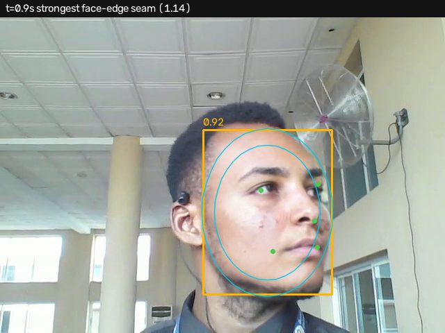
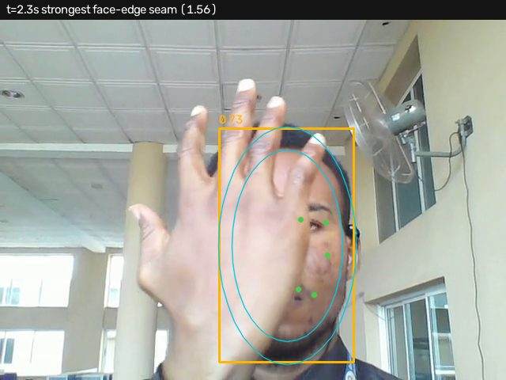

### p01 · real · dim → SUSPICIOUS (risk 0.526)
- When the head turned, the face broke up or jumped instead of turning smoothly.
- The caller was unusually slow to respond to the requests.
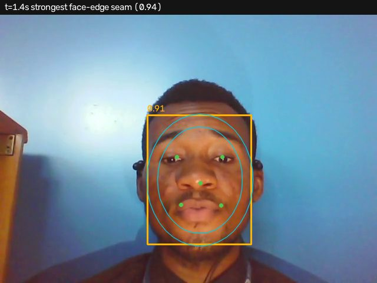
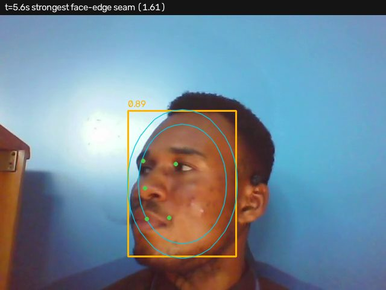
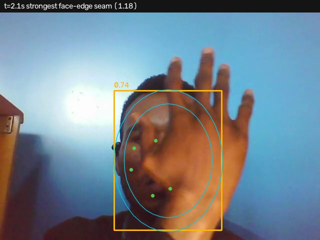

### p01 · real · roomlight → HIGH_RISK (risk 0.752)
- When the head turned, the face broke up or jumped instead of turning smoothly.
- The face stayed visible or 'leaked' over the hand when the hand passed in front of it.
- A visible seam flickers along the edge of the face, typical of a pasted-on face.
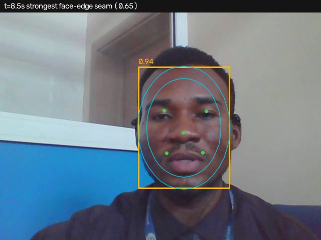
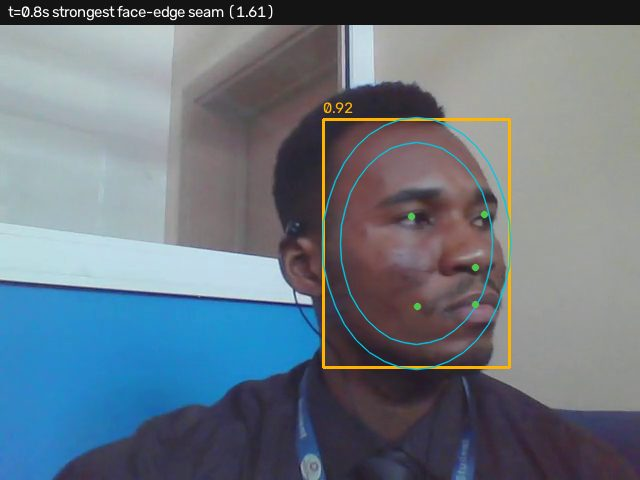
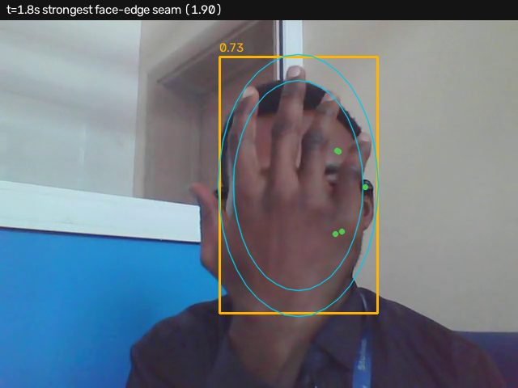

