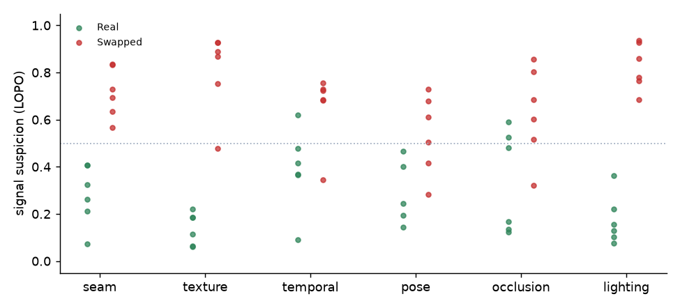
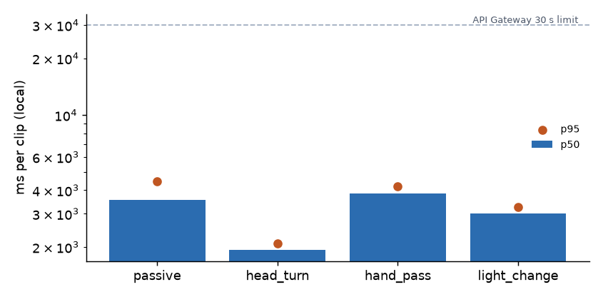

# Evaluation results

> **Data:** SYNTHETIC fixtures (procedurally drawn cartoons, not real people or real face swaps)  
> 48 clips · 6 participants · 12 sessions · generated 2026-10-25 13:15 · thresholds fitted leave-one-participant-out

> ⚠️ These numbers come from synthetic cartoons that were *designed* to contain swap-like artefacts. They only show that the pipeline runs end to end; they are **not** evidence of real-world detection performance.

## Ablation: does choosing challenges adaptively help?

| Strategy | Detection rate (swapped flagged) | High-risk on swapped | False-positive rate (real flagged) | Inconclusive | Swaps missed as LOW_RISK | Avg challenges |
|---|---|---|---|---|---|---|
| (a) Passive only | 100.0% | 33.3% | 0.0% | 50.0% | 0.0% | 0 |
| (b) Fixed sequence | 100.0% | 83.3% | 0.0% | 0.0% | 0.0% | 2.92 |
| (c) Agent-chosen | 100.0% | 83.3% | 0.0% | 0.0% | 0.0% | 2.5 |

## Per-challenge detection (passive + that one challenge)

| Challenge | Detection rate | False-positive rate | n real | n swapped |
|---|---|---|---|---|
| head_turn | 100.0% | 0.0% | 6 | 6 |
| hand_pass | 100.0% | 0.0% | 6 | 6 |
| light_change | 100.0% | 0.0% | 6 | 6 |

## Latency per clip

| Clip | Local p50 (ms) | Local p95 (ms) | Local max (ms) | n |
|---|---|---|---|---|
| passive | 3566.2 | 4459.7 | 4589.8 | 12 |
| head_turn | 1934.1 | 2086.6 | 2087.8 | 12 |
| hand_pass | 3829.2 | 4208.2 | 4518.4 | 12 |
| light_change | 3019.8 | 3250.3 | 4655.1 | 12 |

_Lambda latency: run `make smoke` after deploying to fill this in._

## Agent behaviour

Challenge orders the agent chose:

- `head_turn > hand_pass > light_change`: 8 sessions
- `head_turn`: 2 sessions
- `head_turn > hand_pass`: 1 sessions
- `hand_pass > head_turn > light_change`: 1 sessions

Decision sources: rule: 34, guardrail: 10

## Unusable clips

- no_face: 1

## Failure cases (0)

None in this run (agent strategy).
